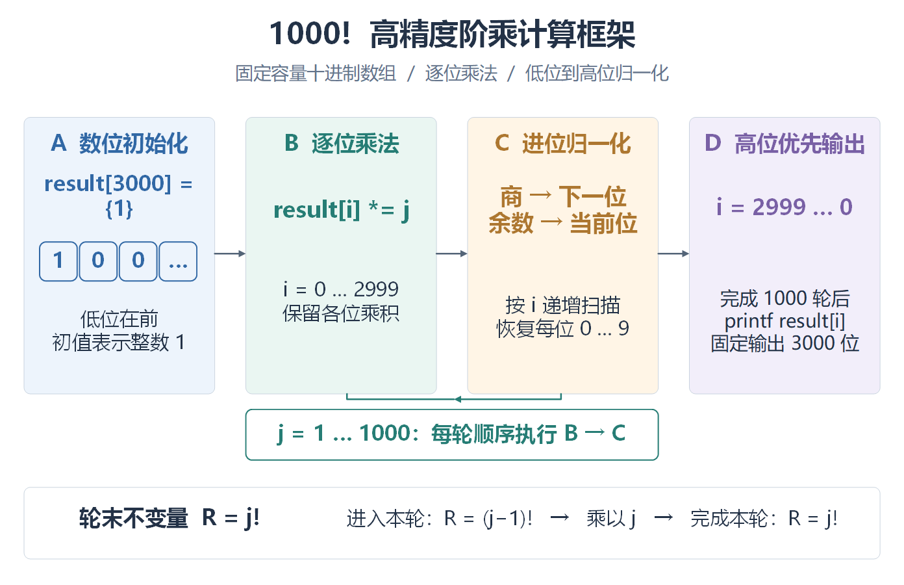

# Lab Report Skill｜中文实验报告编写与排版

把实验思路、关键代码、真实结果和 Word 排版整理到同一套工作流程里。

`lab-report` 是面向 Codex 的中文课程实验报告 Skill，适合计算机、软件工程及相关课程。它根据教师模板、实验要求、代码、截图与日志，辅助编写正文、整理 DOCX、制作实验总览图，并在明确要求时打包最终提交文件。

它来自实际报告整理中积累的规则，重点是 **保留模板、解释原理、核对证据和检查版面**。本仓库提供技能指令与参考规范，不包含自动运行的报告生成程序，也不承诺成绩或一次生成即可提交。

[完整工作流程](#完整工作流程) · [实验文件怎么放](#实验文件怎么放) · [多电脑更新](#多电脑更新) · [阅读技能](lab-report/SKILL.md) · [排版规范](lab-report/references/formatting-standard.md) · [MIT 许可证](LICENSE)

## 能做什么

| 任务 | 处理方式 |
| --- | --- |
| 整理已有报告 | 在内部工作副本中局部编辑，验收后更新唯一当前报告，保留用户手工修改 |
| 编写或补全正文 | 结合真实材料说明目标、原理、关键实现及结果验证 |
| 分析关键代码 | 节选实际源码，解释设计理由、输入输出及与原理的对应关系 |
| 制作实验总览图 | Windows 使用 Visio，macOS 使用 draw.io；PDF 为正式图稿，源文件保留供修改 |
| 整理实验截图 | 核对来源、上下文、图题和最终阅读尺寸下的清晰度；有可用工具时采集真实窗口 |
| 打包提交材料 | 用户审阅后按要求打包，复核报告和核心文件，在提交副本中适配教师要求 |

## 默认规则

- **教师模板优先，明确的用户要求可以覆盖默认规则。** 封面、姓名学号、教师批阅、成绩、签字及评审区默认由使用者手动处理。
- **仅排版不自动扩写。** 只修改指定段落、只插图或只打包时，保持任务范围。
- **实验事实必须有依据。** 不虚构运行结果、截图、测量值、故障经历或测试通过情况；材料不足时留下明确待补项。
- **图和代码要帮助解释实验。** 新写或补全整份报告必须有前部总览图；已有合格图可复用。总览图不替代正文推理，代码节选不替代原理分析，单张截图不证明整体成功率。
- **检查最终 DOCX。** 检查保护区域、格式和图文关系，并渲染检查分页、裁切、图题分离和可读性；工具不足造成的未完成验证应单独说明。
- **日常目录稳定，当前报告唯一。** 不自动堆积“最终版、修改版、v2”等并列稿件；教师提交结构仅在打包副本中实现。

本 Skill 保留了维护者的个人格式预设，例如正文宋体五号、顶层标题宋体四号加粗，以及独立代码块四汉字格左缩进、Times New Roman。文中“用户已确认”指维护者在原始使用过程中的历史选择，不代表学校统一规范或其他使用者的历史授权。请按本次课程和自己的明确要求覆盖这些预设，具体参数见[排版规范](lab-report/references/formatting-standard.md)。

## 完整工作流程

以下是从接收材料到最终提交的默认流程。局部修改只执行相关步骤，不因为使用此 Skill 就重做整份报告。

### 1. 接收材料并明确任务范围

提供实验任务书或评分要求、教师模板或当前报告，以及已有源码、配置、数据、日志和真实截图。原稿中已有的截图无需重复提供；有多份报告时标明以哪份为准。

先判断本次是完整编写、补正文、局部修改、仅排版、仅插图还是最终打包。读取现有材料后只询问影响完成的缺项，不为使用技能索取封面个人信息。

### 2. 整理工作目录并保护原件

按下方[目录示例](#实验文件怎么放)管理报告、素材与实验文件。教师原始模板放在 `报告/原始模板/`，保留原文件名和内容；程序依赖的资源继续放在工程结构中。

收到旧版 `.doc` 模板时，优先使用可用的原生文档工具转换，再与可靠的原始显示结果比较表格、分页、保护区域等。转换成功或文本相同不等于版式保真。无法可靠转换时保留原件，按[转换规则](lab-report/references/doc-conversion.md)说明限制，不把重建稿冒充原模板。

### 3. 阅读模板、要求和证据

实际检查 DOCX 的章节、表格、分节、样式继承、直接格式、图片与页眉页脚，确定可编辑正文和保护区域。

内部建立“实验要求 → 正文章节／核心文件 → 证据 → 完成状态”的对应关系，覆盖教师必答问题、指定测试和必交材料。此检查不默认展示给用户，也不写入报告；只说明真实缺项和冲突。截图、日志和测试结论按其实际支持的范围使用。

### 4. 编写正文和制作图示

关键任务按“目标与输入 → 原理及选择理由 → 实现步骤与关键代码 → 结果及验证”展开，解释为什么这样做、关键实现如何对应原理，以及结果如何支撑结论。缺少结果时明确待补，不虚构成功、故障或个人经历。

完整报告在正文前部放一张实验总览图；按实验内容选择流程、结构、数据通路或状态变化图，已有合格图则复用或更新。Windows 新图默认用 Visio，macOS 新图默认用 draw.io，均参考本仓库的配色与构图规则。仅排版或局部修改不自动新增图，用户明确要求可覆盖默认工具与图示安排。

图稿使用同一条链路：

```text
可编辑源图（.vsdx / .drawio） → 正式 PDF → 清晰 PNG → DOCX 插图
```

PDF 是正式图稿。源文件和 PNG 留在素材目录供后续修改，不强制作为交付附件或装入提交包。检查语义、分支、回路、布局和缩入报告后的字号；截图检查真实来源、遮挡、操作高亮及入稿清晰度。

### 5. 排版、验收并更新当前报告

在 `.work` 内的工作副本中局部编辑，保留模板表格、媒体、关系及保护区域。核对正文和代码格式、图号与引用、图片尺寸、节属性和共享样式影响，并渲染查看相关页面及整体分页。

完成适用检查后更新同一路径的当前 DOCX，交付该路径、简短变更说明及待补项。写回前再次比较当前文件：若用户期间又有手工修改，先基于最新文件应用局部改动，不能覆盖新增内容。未完成关键版式检查时保留当前主文件，并说明待验收副本位置。

### 6. 用户审阅与反复修改

用户与助手围绕同一份当前报告继续调整，每次重新读取最新文件，不从旧生成稿重建。内部默认只保留一份由本 Skill 创建的最近修改前回退副本；原始模板、证据及用户自己的归档不受此数量限制。

源图、正式 PDF 和入稿图同步更新并沿用稳定名称。报告或核心文件变动后，之前的压缩包视为过期，仅在用户再次要求打包时重新生成。

### 7. 用户要求打包后，做最后一次内部复核

以用户已经审阅的报告和核心文件为准，检查教师必交项、最终版本、命名、残留待补项、图号引用、依赖及已知未完成验收。复用对当前版本仍有效的检查结果，不默认重跑全部实验，也不重写已经接受的报告或源码。

没有新问题就继续打包，不重复请求确认。若发现影响正确性或提交完整性的具体缺口，只说明该问题；需要用户决定时再询问，不把有关键缺口的包宣称为可直接提交。

### 8. 按教师要求生成提交副本并交付

在 `.work` 中建立独立打包暂存目录，复制当前报告及运行必需的源码、配置、工程和资源。教师要求的名称、包内目录和压缩格式只作用于提交副本，**不改动日常工作目录**。重新组织后仍要满足相对路径依赖，不能静默修改已审阅源码来迁就目录。

默认不装入教师模板、图稿及绘图源文件、截图附件、旧稿、缓存、日志或内部工作文件；教师明确要求或程序运行依赖的材料除外。没有特殊要求时生成与当前报告同名的 ZIP。

检查包内清单、压缩完整性、报告和源码与选定版本的内容一致性，再在独立解压目录完成适度的依赖或启动检查。已有同名包时先验证新包，再更新交付包。最终提供当前压缩包和简短检查结论，准确说明实际验证范围，不把配置检查称为完整运行测试。

## 实验文件怎么放

```text
实验02_主题/
├── 报告/
│   ├── 实验02_主题.docx           # 唯一当前报告，后续持续修改
│   └── 原始模板/
│       └── 教师提供的原文件名.docx # 或 .doc，原件保持不变
├── 素材/
│   ├── 实验要求/                 # 任务书、评分标准等
│   ├── 截图/                     # 真实原图与有来源对应的处理副本
│   └── 流程图/
│       ├── 实验总览.drawio        # Windows 可为 .vsdx
│       ├── 实验总览.pdf           # 正式图稿
│       └── 实验总览.png           # 从 PDF 生成的入稿图
├── 实验文件/                     # 保持原工程及运行依赖结构
├── .work/                        # 内部暂存、检查、回退和打包副本
└── 实验02_主题.zip               # 仅要求打包时生成，可按教师要求命名
```

名称是示例，沿用当前实验和用户确认的名称；没有对应材料时不创建空目录。既有项目先检查依赖，不为分类而随意迁移。报告插图属于素材，程序实际读取的图片、模型和输入数据属于实验文件。

例如教师要求提交包内为 `学号/report.docx` 和 `学号/code/`，只在暂存副本中形成该结构，原来的 `报告/`、`素材/` 和 `实验文件/` 保持不变。完整规则见[目录与当前报告管理](lab-report/references/file-management.md)。

## 安装

### 方式一：让 Codex 安装

在支持 `$skill-installer` 的 Codex 环境中发送：

```text
$skill-installer 请从 https://github.com/Tcskywttc/lab-report-skill
安装 lab-report 目录中的技能。若已安装同名技能，先比较差异，不要直接覆盖我的定制版本。
```

### 方式二：手动安装

1. 点击仓库的 **Code → Download ZIP**，下载并解压。
2. 将里面的 **`lab-report` 文件夹**放入个人技能目录；已有安装时先按下节处理本地改动。
3. 确认 `SKILL.md` 直接位于 `lab-report/` 下，不要多套一层同名目录。

按 [OpenAI 官方技能文档](https://learn.chatgpt.com/docs/build-skills)，本地个人技能目录为：

| 系统 | 目标文件位置 |
| --- | --- |
| Windows | `%USERPROFILE%\.agents\skills\lab-report\SKILL.md` |
| macOS / Linux | `~/.agents/skills/lab-report/SKILL.md` |
| 仅当前项目使用 | `<项目根目录>/.agents/skills/lab-report/SKILL.md` |

如果现有环境通过安装器使用其他技能目录（例如 `~/.codex/skills`），以该环境实际识别的目录为准；避免在多个目录重复安装同名技能。未显示新技能时，重启客户端后再检查。

## 多电脑更新

**本仓库是共享更新来源；两台电脑各自安装的技能文件需要分别更新。** 登录同一个 Codex 账号不等于本地技能目录已经同步。Git 拉取仓库也不等于更新另一位置的已安装副本。

Windows 或 macOS 上可以直接把这段发给 Codex：

```text
请从 https://github.com/Tcskywttc/lab-report-skill 的 main 分支更新 lab-report 技能。
先找出当前环境实际使用的技能目录，读取远端最新提交并比较本地差异。
本地独有修改先备份并保留；可明确合并的差异直接合并，有冲突时说明具体内容。
更新整个 lab-report/，包括 SKILL.md、agents、references、examples 和 assets，
不要只复制 SKILL.md，也不要重复安装同名技能。
核对相对链接、视觉样例和已安装文件，报告采用的提交 SHA 及仍保留的本地差异。
```

手动维护仓库时，在没有未处理本地改动的仓库目录执行：

```sh
git pull --ff-only origin main
```

再比较并更新实际安装目录中的完整 `lab-report/`。拉取失败时先处理本地改动或分叉，不使用强制覆盖。若直接把仓库克隆在技能搜索根目录并由客户端识别其 `lab-report/`，应先确认实际加载路径，避免额外复制一份。

修改技能后，先把需要共享的改动提交到本仓库，再在另一台电脑更新。同步范围只需本技能及其资源，不需要同步整个 Codex 配置目录。README 是使用说明，安装时的技能内容位于 `lab-report/`。

## 怎么使用

### 补全报告正文

```text
$lab-report 请根据本次实验材料补全报告正文。

实验要求：见“素材/实验要求”
当前报告：见“报告/实验02_主题.docx”，以这份最新文件为准
代码与结果：见“实验文件”及“素材/截图”
需要补充：原理、关键代码分析、结果验证和结论
总览图：Windows 用 Visio，macOS 用 draw.io；PDF 为正式图稿
保护区域：封面和教师评审区域保持原样
材料不足：明确待补证据，不编造结果
验收后更新同一份当前报告，不生成多份并列版本；暂不打包
```

### 只调整格式

```text
$lab-report 只整理这份当前报告的正文排版，保留原文与实验事实。
不要扩写或新增总览图；封面和教师评审区域保持原样。
内部副本验收后更新当前报告，并说明实际完成的版面检查。
```

### 打包最终提交文件

```text
$lab-report 报告和核心文件我已审阅，请以“报告/实验02_主题.docx”
及当前实验文件为准，最后内部检查一次，然后打包。
按“素材/实验要求”里的提交规定组织包内目录和命名，
只在打包副本中调整，不改变日常目录，不改写报告或源码。
没有特殊要求时，只打包当前报告与运行必需文件，生成同名 ZIP。
```

也可以在技能选择器中选中 `lab-report` 后直接描述任务。具体的技能调用界面因客户端而异。

## Visio 样例与 draw.io 适配

仓库提供软件工程 exp3 的三页可编辑视觉样例，以及从实际 VSDX 提取的配色、字号、线宽和布局说明：

- [下载可编辑 Visio 样例](lab-report/assets/visio-exp3/exp3-flowchart-reference.vsdx)
- [查看配色与构图分析](lab-report/references/visio-exp3-design.md)
- [查看 draw.io 适配规则](lab-report/references/drawio-adaptation.md)
- [算法全景](lab-report/assets/visio-exp3/01-overview.svg)、[完整控制流](lab-report/assets/visio-exp3/02-control-flow.svg)、[进位机制](lab-report/assets/visio-exp3/03-carry-mechanism.svg)矢量预览



新图默认借鉴“浅色职责分区 + 深色标题与描边”的蓝、青绿、琥珀、紫配色，以及阶段总览、职责分栏、状态局部展开三种构图。按内容选用，不要求每次四色或三张图。规则同时要求检查最终入稿字号和回路连线。

这些视觉规则可以迁移到 draw.io，按[适配说明](lab-report/references/drawio-adaptation.md)映射形状、颜色、字体和连接线；不是要求复刻 Visio 的内部对象或 Windows 字体。仓库目前提供的是 VSDX 样例和 draw.io 适配说明，**尚未附带原生 `.drawio` 样例**。

VSDX 文件含原实验内容，不是空白 `.vstx` 模板。个人作者元数据已去除，原生形状与文字保留；部分连接采用手工折线，移动节点后须重接或核对。样例算法与数值不作为其他实验的结果证据。

## 环境与交付

Skill 本身是 Markdown、YAML 与参考资源；实际编辑、渲染、截图和绘图取决于运行它的智能体及可用工具。

| 工作 | 所需能力与交付边界 |
| --- | --- |
| DOC / DOCX 处理 | 需要转换、编辑和渲染工具；字体或渲染器缺失时说明保真与验收限制 |
| Windows 绘图 | 默认使用 Microsoft Visio；COM 自动化需要本机环境支持 |
| macOS 绘图 | 默认使用 draw.io，保留可编辑 `.drawio`；工具缺失时说明阻碍或按用户要求调整 |
| 图稿导出 | 正式 PDF → 清晰 PNG → DOCX；检查字体、裁切、连线和最终尺寸 |
| 自动截图 | 需要当前环境支持的电脑操作或截图工具，以及可访问的真实实验窗口 |
| 打包与运行验证 | 需要文件访问与相应压缩工具；验证范围由运行环境和任务授权决定 |

普通报告任务交付唯一当前 DOCX 的位置和简短说明，图稿 PDF 保留供查看。VSDX／`.drawio` 和入稿图在素材目录中供后续修改，不是强制交付附件。明确要求打包时再生成提交包，具体见[打包规则](lab-report/SKILL.md#最终提交打包)。

## 仓库结构

```text
lab-report-skill/
├── README.md
├── LICENSE
├── .gitignore
└── lab-report/
    ├── SKILL.md
    ├── agents/
    │   └── openai.yaml
    ├── assets/
    │   └── visio-exp3/                  # VSDX 与三页 SVG / PNG
    ├── examples/
    │   └── good-report-example.md
    └── references/
        ├── doc-conversion.md
        ├── docx-template-rule.md
        ├── drawio-adaptation.md
        ├── evidence-rule.md
        ├── file-management.md
        ├── flowchart-guide.md
        ├── formatting-standard.md
        ├── report-structure.md
        ├── screenshot-guide.md
        ├── visio-exp3-design.md
        └── writing-guideline.md
```

仓库仅附带上述脱敏 Visio 视觉样例，未附带完整学生报告、学校教师模板、个人截图、真实实验数据或软件安装包。写作和图形示例用于说明组织方法，不能作为新实验的证据。

## 反馈与改进

欢迎通过 [Issues](https://github.com/Tcskywttc/lab-report-skill/issues) 或 Pull Request 反馈。描述任务类型、预期行为、实际问题和使用环境即可；需要复现材料时，请先脱敏并确认有权公开，尤其注意姓名、学号、成绩、账号、路径和截图中的个人信息。

优先欢迎能复现的问题，例如局部编辑扩大了修改范围、保护区域发生变化、图文不同步、代码换行破坏含义或打包漏掉依赖。

## 参考与许可

开源仓库的介绍与使用说明组织方式参考了 [hanyu0510/SZU-CS-high-score-lab-report-skill](https://github.com/hanyu0510/SZU-CS-high-score-lab-report-skill)。本仓库发布的是维护者已有的 `lab-report` 技能，没有复制该仓库的报告图片或模板。

本项目采用 [MIT License](LICENSE)。本项目是个人维护的实验报告工作流，不代表学校或课程官方要求。使用时请遵循本课程关于独立完成实验、材料使用和 AI 辅助披露的规定。
