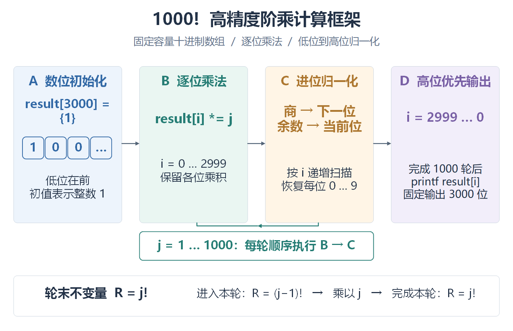
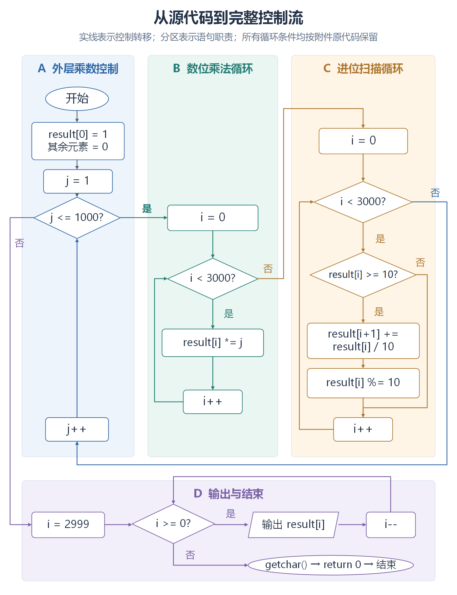
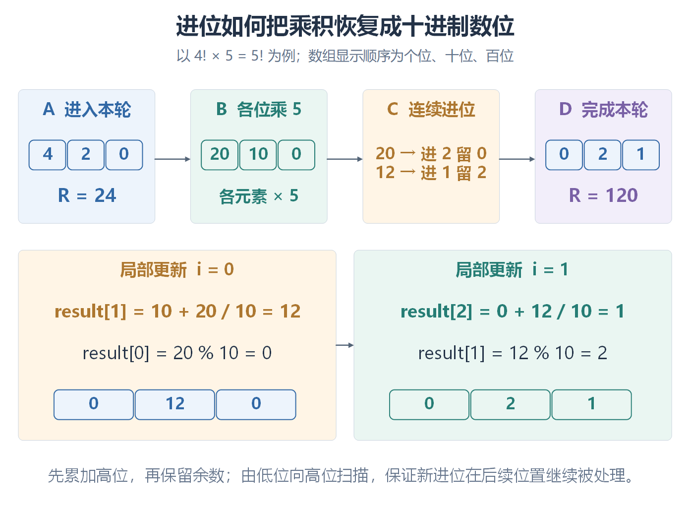

# 软件工程 exp3：Visio 视觉样例与迁移规则

本参考依据维护者提供的 exp3 最终 Visio 文件，结合三页实际导出图、VSDX 内的形状属性及原始绘图定义整理。它是已认可的视觉基线，供新图优先借鉴；不是学校官方模板，也不是把历史算法、参数或验证结论复制到新实验的依据。用户或课程指定其他视觉规范时遵从指定要求。

## 可下载的样例

- [可编辑 VSDX](../assets/visio-exp3/exp3-flowchart-reference.vsdx)：含“算法全景、完整控制流、进位机制”三页，保留原生形状与文字；发布副本仅将作者及最后修改者元数据改为公开账号，图形内容不变。
- [算法全景 SVG](../assets/visio-exp3/01-overview.svg) / [PNG](../assets/visio-exp3/01-overview.png)
- [完整控制流 SVG](../assets/visio-exp3/02-control-flow.svg) / [PNG](../assets/visio-exp3/02-control-flow.png)
- [进位机制 SVG](../assets/visio-exp3/03-carry-mechanism.svg) / [PNG](../assets/visio-exp3/03-carry-mechanism.png)

这是带有原实验内容的 `.vsdx` 样例，不是空白 `.vstx` 模板。使用时另存副本，先重新确定本次实验的节点、边、条件和证据，再复用视觉结构。PNG 为网页预览导出，正式入稿优先采用兼容的 SVG，或从最终 VSDX 按所需尺寸重新导出 PNG。

## 三种构图分别解决什么问题

### 1. 总览：横向阶段卡片与底部关键关系

- 顶部深色主标题回答“这张图讲什么”，次行灰蓝副标题概括对象与方法。
- 中部从左到右排列 A–D 阶段卡片。卡片内依次放阶段名、关键表达式或对象、简短解释，连线穿过卡片间留白。
- 用小数组格展示初始表示，用公式描述核心处理，让读者直接看到数据对象；等宽卡片本身并不构成问题，只有标题、没有关系或机制的卡片才缺少解释力。
- 循环关系单独放在卡片下方，底部用一条横跨画布的浅边框区域解释轮末不变量。主步骤、循环约束和原理依据分层，避免挤在同一排。

迁移时可用于实验实施阶段、数据处理流水线和模块协作总览。阶段数由内容决定；没有循环或不变量时，不保留无依据的底栏。

### 2. 控制流：职责分栏与独立的输出区域

- 上部按外层控制、乘法、进位三类职责分成纵向区域，各区内部主要从上向下读。
- 下部把输出与结束放在横向区域，使退出路径与主体循环分开。
- 控制流节点用白底和所属阶段的描边；判断用菱形、输入输出用平行四边形，起止用椭圆。区域颜色负责分组，形状负责表达控制语义。
- 局部循环沿区域侧边返回；跨区大回路走外侧通道，条件标签放在对应出口附近。留白需要在排节点之前预留，不能画完节点再让线穿过标题。

这里的分栏表达语句职责，不表示并行执行。只有实际并发时才画并行语义。窄报告版面放不下时，应拆分并标明入口、出口和续接点，不能直接把整张长图缩小。

### 3. 机制解释：上层状态变化与下层局部展开

- 上层用数组格与数值展示“进入本轮 → 乘法中间态 → 连续进位 → 完成本轮”。
- 下层把两个局部更新并排展开，给出索引、商余计算及更新后的数组。
- 底部一句话解释更新顺序为何重要。它补充了总览与控制流中不易看出的因果关系。

迁移时优先选择位字段、寄存器、数组、信号、坐标或状态等真实对象；不要把机制图退化成另一张操作步骤清单。样例的 `4! × 5` 是算法推导示例，整数除法按原程序语义理解，不是本次新实验的实测数据。

## 配色：实际色值与使用方式

下列 HEX 值来自最终 VSDX 的显式颜色，非截图取样近似值。

| 角色 | 深色 | 浅色背景 | 样例用途 |
| --- | --- | --- | --- |
| 蓝 | `#3168A5` | `#EDF4FC` | 初始化、外层控制 |
| 青绿 | `#267D75` | `#EAF6F2` | 乘法处理 |
| 琥珀 | `#AD7730` | `#FFF5E6` | 进位、归一化 |
| 紫 | `#7960A5` | `#F2EEFA` | 输出、完成态 |
| 主文字 | `#233247` | — | 正文、变量、主标题 |
| 次文字 | `#64748B` | — | 副标题、辅助说明 |
| 中性连线 | `#536477` | — | 总览中跨阶段的普通连线 |
| 分区边框 | `#CAD4DF` | — | 轻量容器边框 |
| 画布与节点 | — | `#FFFFFF` | 白底画布、控制流节点 |

迁移到新图时：

1. 简单图选一个主色和一个强调色即可；有明确多阶段职责时可使用上述 2–4 组色。按职责分配颜色，不轮流给每个节点换色，也不要求四色全部出现。
2. 采用“浅底分区 + 深色区标题/描边 + 深色正文”。颜色不能替代 A/B/C、阶段名、条件和箭头，也不能仅用红绿表示是否完成。
3. 同一职责跨图保持颜色一致。新图中的局部展开也应沿用对应职责色；若颜色用于区别迭代或状态，需显式说明该局部含义。
4. 新节点的具体语义不一定对应样例的蓝/绿/黄/紫职责，但一组图内必须稳定。跨区连线可采用目标区域色表示下一步归属，或统一中性灰；选择后保持一致，回边归属应清楚。
5. 琥珀等彩色小字缩小后较轻，关键变量、长解释和小字号正文优先用 `#233247`；将角色色留给短标题、边框及重点标记。
6. 不照搬渐变、阴影、彩虹配色或装饰图标。灰度查看时，文字、区域边界与线型仍需能区分含义。

## 布局与尺寸：提取值不是固定画布

样例三页均宽 11.6 in，高分别为 7.5、15.1、8.6 in，适合表达三种不同的信息密度。它们不是 A4 尺寸，不能原尺寸或原字号直接套进所有报告。

| 项目 | 样例实测或绘图定义 | 迁移建议 |
| --- | --- | --- |
| 外边距 | 总览左右各约 0.3 in，约为画布宽度的 2.6% | 保持整齐边界，通常可从宽度的 3% 左右起步 |
| 主区域 | 总览四卡片、控制流三纵区加底区、机制图上四下二 | 根据关系选结构；不是每次都要三页或四阶段 |
| 总览卡片间隔 | 约 0.4 in，约为画布宽度的 3.4% | 为箭头与标签保留可见通道，复杂回路需要更多留白 |
| 分区/节点/连线粗细 | 0.8 / 1.2 / 1.5 pt | 保持层次，最终缩放后重新检查可见性 |
| 圆角 | 0.08 in | 轻量圆角，不改变判断、输入输出等语义形状 |
| 字体 | Microsoft YaHei | 图内保持统一；字体不可用时选可用中文字体并重新检查换行 |
| 主标题/区域标题 | 27.36 / 20.16 pt | 根据最终插入尺寸设置层次，不把原字号当交付门槛 |
| 正文与副标题 | 常见正文 17.28–20.88 pt，副标题 16.56 pt | 优先保证最终关键文字约 9 pt 以上，再确定画布和字号 |

同层卡片、数组单元和同类节点可以等宽、等高。层级来自标题、对象、解释和关系，而不是刻意让每个框不同。节点内边距要让文字与边线分离，较长公式应增加节点宽度或拆出局部图，不压小字号。

### 必须按最终报告尺寸复核

样例画布宽约 29.46 cm。插入宽 12.399 cm 的报告时，缩放系数约为 0.421；原图 18.72 pt 的文字会降至约 7.88 pt，16.56 pt 副标题会降至约 6.97 pt。因此网页预览清楚不等于报告中合格。

按 `最终字号 = 原图字号 × 插入宽度 / 原图宽度` 估算。若维持样例画布宽度且目标为约 9 pt，原图关键文字应至少约 21.4 pt，并重新安排空间；更适合的办法常是减字、改纵向构图或拆图。字号门槛是迁移建议，不能宣称原样例已经全部满足。

## 连线：保留优点，同时修正易错之处

- 样例的最终版本已经把总览的回边箭头放到水平段上，并把输出循环的横向回边抬到区域标题上方。新图应延续“箭头方向明确、标题区留空”的原则。
- 优先使用动态连接线并粘附节点连接点，移动节点后检查连接是否仍成立。
- 此 VSDX 三页分别包含 32、65、43 个原生对象，但各页 XML 中均无 `Connect` 记录，连线主要由手工折线组成。它们可编辑，**不能据此声称会自动跟随节点**。复用时应重接关键连线，或逐条修正端点与折点。
- 每个判断出口都标明条件，标签与对应线保持邻近；汇合要确实接到同一点，不以视觉相交冒充连接。
- 说明性关联线与控制转移要区分。若选用虚线表示说明关系，在图中说明含义；不能把职责分组误画成控制步骤或并行路径。

## 从样例应用到新实验

1. 读取本次材料，列出需要解释的阶段、状态、判断、循环和关键对象。
2. 在“阶段总览、完整控制流、局部机制”中选必要图型；简单任务可只画一张。
3. 先确定报告可用宽度、目标字号、分区和回线通道，再放节点。窄版面优先纵向或上下分层。
4. 建立本次职责与配色映射，沿用本参考的浅底/深描边体系；把旧算法、常量、标题和状态全部替换为本次内容。
5. 用原生形状表达对象和关系。先验证逻辑与方向，再检查对齐、留白、字号、颜色和遮挡。
6. 从最终 VSDX 导出，检查导出图及报告实际插入效果。修改图后同步源文件、导出文件和 DOCX；复用样例不免除验收。

本参考只提供图形设计基线。执行实验和验证结果仍遵循[证据规则](evidence-rule.md)，报告放置、图题和交付范围遵循[流程图规范](flowchart-guide.md)。
